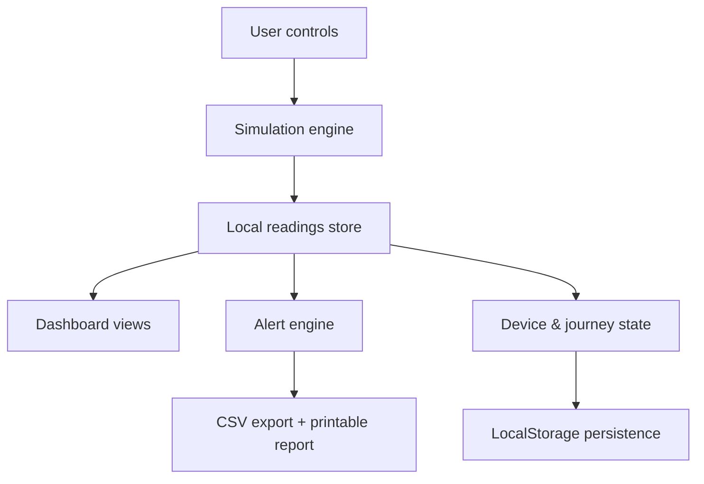

# ColdChainMonitoring

## Hariyali ColdGuard

Hariyali ColdGuard is a simulated cold-chain monitoring dashboard for vegetable transport. It models environmental readings, threshold events, offline-first behaviour, and journey visibility without requiring physical IoT devices.

## Problem statement

The Hariyali Farmers' Cooperative transports produce from 120 farms to a city market over a long route. The current process loses about 18% of produce in transit, but the team cannot identify exactly when or where conditions become risky. The goal is to create a plausible operational monitoring dashboard that simulates environmental data, risk logic, and alerting behavior for training and demonstration purposes.

## Proposed solution

The application provides a dark operational dashboard with a sidebar, summary cards, live sensor charts, alert history, device simulation, and reporting features. Data is generated deterministically within the browser, persisted in LocalStorage, and can be manipulated to demonstrate normal operation, excursions, offline mode, sensor faults, and synchronization behaviour.

## Architecture

The front-end is a React + Vite client application. State is stored in the browser using LocalStorage so the simulation can survive refreshes. The application separates simulation logic, alert generation, and UI rendering into a single component file for a compact implementation.

## Technology stack

- React
- Vite
- JavaScript
- Recharts
- Lucide React
- LocalStorage persistence

## Installation

1. Open a terminal in the project folder.
2. Install dependencies:
   npm install

## Run locally

npm run dev -- --host 0.0.0.0

Then open the local address printed in the terminal, typically http://localhost:5173.

## Demonstration instructions

- Start the simulation to watch readings update.
- Use "Excursion" to trigger a sustained high-temperature event.
- Use "Offline" to simulate loss of connectivity while continued readings are recorded locally.
- Use "Reconnect" to synchronize pending records.
- Use "Sensor fault" to simulate invalid readings.
- Use the settings page to modify thresholds and update intervals.
- Refresh the browser to confirm that state persists in LocalStorage.

## Known limitations

- This is a software simulation only; no physical sensor hardware is connected.
- The threshold values are demonstration defaults and require verification before field deployment.
- No backend or cloud service is used; synchronization is a local front-end simulation only.

## Future hardware integration plan

The current simulation can be replaced with an actual telemetry pipeline by connecting real sensor gateways, formatting readings into the same data model, and storing them in a backend service. The UI would remain largely unchanged, while the simulation engine would be swapped with real device ingestion.

## Data disclosure

All sensor readings, alerts, battery telemetry, and journey states are simulated for demonstration, operator training, and software UI validation. They do not represent measured field conditions from hardware devices.
